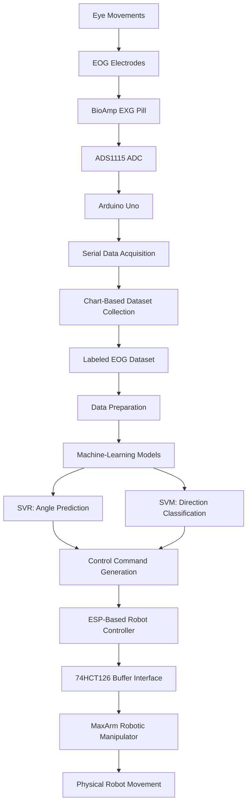

# BE Capstone Project

## 🎥 Project Demonstration [](https://youtu.be/LLZSEM22tTs?si=Ve9w69eN5hiVtP-J)

# EOG-Based Robotic Manipulator Control Using SVR Angle Prediction and SVM Direction Classification

## Project Overview

This project presents a machine-learning-based Electrooculography (EOG) control system designed to operate a robotic manipulator using eye movements. The system integrates EOG signal acquisition, chart-based dataset collection, Support Vector Regression (SVR), Support Vector Machine (SVM) classification, PCB design, and robotic hardware integration using the MaxArm robotic manipulator.

Unlike conventional camera-based eye-tracking systems, this approach uses electrical potential variations associated with eye movements to estimate viewing angles and identify directional actions. EOG measurements are acquired, digitized into ADC values, and associated with corresponding reference angles using a calibration chart.

The collected dataset is used to train two machine-learning models. **Support Vector Regression (SVR)** predicts the corresponding angle from EOG measurements, while **Support Vector Machine (SVM)** classifies eye movements into four directional actions: UP, DOWN, LEFT, and RIGHT.

The initial models have been tested using their existing parameter configurations, without hyperparameter tuning, to observe their baseline behavior. Preliminary robotic movement and communication checks have also been conducted using the MaxArm robotic manipulator and a 74HCT126 buffer IC in the servo communication interface.

The remaining development focuses on model parameter optimization and real-time integration of the predicted angle and classified direction with the robotic control system.

---

## Table of Contents

- [Problem Statement](#problem-statement)
- [Project Objectives](#project-objectives)
- [Team Details](#team-details)
- [Guide Details](#guide-details)
- [System Architecture](#system-architecture)
- [Hardware Requirements](#hardware-requirements)
- [Software and Technologies](#software-and-technologies)
- [Working Methodology](#working-methodology)
- [Machine-Learning Approach](#machine-learning-approach)
- [Robotic Manipulator Integration](#robotic-manipulator-integration)
- [Project Progress and Current Status](#project-progress-and-current-status)
- [Performance Evaluation](#performance-evaluation)
- [Limitations](#limitations)
- [Future Scope](#future-scope)
- [Conclusion](#conclusion)
- [References](#references)

---

## Problem Statement

Conventional eye-tracking systems often rely on cameras, infrared illumination, or dedicated commercial hardware, which can increase implementation cost and complexity. A low-cost alternative is desirable for translating eye movements into control commands for robotic applications.

Electrooculography provides a method of detecting eye movements by measuring electrical potential variations associated with changes in eye position. However, EOG signals can be affected by baseline drift, electrical interference, electrode placement, and individual physiological differences.

A calibrated data acquisition and machine-learning approach is therefore required to map EOG measurements to reference angles and directional commands.

The objective of this project is to develop an EOG-based robotic manipulator control system that uses SVR for angle prediction and SVM for directional classification, enabling eye-movement-based control of a MaxArm robotic manipulator.

---

## Project Objectives

- Develop an EOG-based human–machine interface for robotic manipulation.
- Acquire and digitize EOG signals using an ADC-based acquisition system.
- Collect a labeled dataset using predefined points on a calibration chart.
- Associate recorded ADC measurements with their corresponding reference angles.
- Train an SVR model to predict angles from EOG measurements.
- Train an SVM model to classify UP, DOWN, LEFT, and RIGHT actions.
- Test the initial trained models using their existing parameter configurations.
- Design a PCB for the project hardware.
- Interface the ESP-based controller with the MaxArm robotic manipulator.
- Use a 74HCT126 buffer IC in the servo communication interface.
- Integrate real-time model predictions with robotic movement commands.
- Tune model parameters and evaluate prediction accuracy, classification performance, response time, and movement repeatability.

---

## Team Details

| Sr. No. | Name | Roll No. | Branch |
|---|---|---:|---|
| 1 | Shrawan Rakesh Rane | 24 | Automation and Robotics |
| 2 | Vinod Santosh Kale | 05 | Automation and Robotics |
| 3 | Dhanush Balasubramaian | 37 | Automation and Robotics |
| 4 | Rahul Kumar Yadav | 33 | Automation and Robotics |

## Guide Details

- **Project Guides:** Dr. Sangeeta Prasannaram / Kader Shaikh
- **Department:** Automation and Robotics
- **Institute:** Vivekanand Education Society's Institute of Technology (VESIT), Mumbai, India

---

## System Architecture

The proposed system consists of EOG signal acquisition, dataset development, machine-learning inference, command generation, and robotic actuation.



**Current implementation status:** Dataset collection, initial model training, preliminary model testing, PCB design, and initial robotic hardware checks are complete. Real-time integration and model parameter tuning remain pending.

---

## Hardware Requirements

| Component | Purpose |
|---|---|
| EOG Electrodes | Acquire electrical signals associated with eye movements |
| BioAmp EXG Pill | Amplify and condition EOG signals |
| ADS1115 ADC | Convert analog signals into digital measurements |
| Arduino Uno | Acquire ADC measurements and transmit data |
| Computer/Laptop | Dataset processing, model training, and inference |
| ESP-Based Controller | Receive control commands and interface with the robot |
| 74HCT126 Buffer IC | Buffer and interface servo communication signals |
| MaxArm Robotic Manipulator | Execute the requested robotic movements |
| PCB | Hardware interconnection and circuit implementation |
| Power Supply | Provide appropriate power to the robotic system |
| Connecting Wires | Establish electrical interconnections |

---

## Software and Technologies

| Technology | Purpose |
|---|---|
| Python | Dataset processing and machine-learning implementation |
| NumPy | Numerical computation |
| Pandas | Dataset organization and analysis |
| Scikit-learn | SVR regression and SVM classification |
| Matplotlib | Dataset visualization and performance plots |
| Arduino IDE | Microcontroller firmware development |
| Serial Communication | Transfer acquisition data and robot commands |
| ESP32 Arduino Core | Firmware development for the ESP-based controller |

---

## Working Methodology

### 1. EOG Signal Acquisition

Surface electrodes acquire electrical potential variations associated with horizontal and vertical eye movements. The BioAmp EXG Pill conditions the signals, which are digitized using the ADS1115 ADC.

The Arduino Uno reads the ADC measurements and transmits the data to a computer for dataset collection and processing.

**Status:** Acquisition workflow used for dataset collection.

### 2. Chart-Based Dataset Collection

A calibration chart containing predefined points is used to collect labeled EOG measurements. During data collection, the user sits approximately **45 cm away from the chart** and looks at the designated points.

For each point, the corresponding ADC values are recorded and associated with the reference angle represented by that point. Directional labels are also assigned to the collected data for supervised classification.

This creates a labeled dataset containing EOG measurements, reference angles, and directional classes.

**Status: Completed.**

### 3. Dataset Preparation

The collected measurements are organized into input features and target labels.

- **Input features:** Acquired EOG ADC measurements or the selected EOG feature representation.
- **Regression target:** Corresponding reference angle.
- **Classification target:** Directional action — UP, DOWN, LEFT, or RIGHT.

The prepared dataset is used to train and test the machine-learning models.

**Status: Dataset collection and preparation for initial model training are completed.**

### 4. SVR-Based Angle Prediction

Support Vector Regression is used to estimate the corresponding angle from EOG measurements.

The SVR model learns the relationship between recorded ADC values and the reference angles in the calibration dataset. Once trained, the model receives EOG input measurements and generates an angle prediction.

The predicted angle is intended to serve as an input to the robotic control layer.

**Status:** Initial model training and preliminary testing completed. Hyperparameter tuning and real-time robotic integration remain pending.

### 5. SVM-Based Direction Classification

A Support Vector Machine classifier identifies the directional action associated with the EOG input.

The four directional classes are:

- **UP**
- **DOWN**
- **LEFT**
- **RIGHT**

The predicted direction provides the directional component of the robotic control command.

**Status:** Initial model training and preliminary testing completed. Hyperparameter tuning remains pending.

### 6. Preliminary Model Testing

The initially trained SVR and SVM models were tested using their existing parameter configurations, without performing hyperparameter tuning. The purpose of this stage was to observe the models' initial behavior and establish a baseline for further development.

This preliminary testing helps assess whether the models produce usable angle predictions and directional classifications before additional optimization is performed.

The baseline results can subsequently be compared with the results obtained after parameter tuning.

**Status: Completed.**

*Note: Preliminary testing establishes initial model behavior; it does not imply that the models have reached their final optimized performance.*

### 7. PCB Design

The printed circuit board design for the project hardware has been completed. The PCB forms part of the hardware development intended to support the EOG acquisition and control system.

**Status: PCB design completed.**

### 8. Robotic Hardware Testing

Preliminary movement and communication checks have been conducted on the MaxArm robotic manipulator using the 74HCT126 buffer IC in the servo communication interface.

These checks establish an initial hardware-testing milestone before integrating the real-time predictions generated by the machine-learning models.

**Status: Preliminary robot trial checks completed.**

### 9. Real-Time Control Command Generation

The SVR and SVM outputs are intended to be combined by the control application. The resulting command will contain the predicted angle and classified direction.

The command will then be transmitted to the ESP-based robot controller for execution through the MaxArm servo system.

**Status: Real-time model-to-robot integration remains pending.**

---

## Machine-Learning Approach

### Support Vector Regression (SVR)

SVR is used for the continuous angle-prediction task.

- **Input:** EOG ADC measurements or the selected EOG feature representation.
- **Output:** Predicted reference angle.
- **Purpose:** Estimate the angle associated with the current EOG input.

The model learns a regression relationship between the input measurements and the labeled angles in the training dataset.

### Support Vector Machine (SVM)

SVM is used for directional classification.

- **Input:** EOG ADC measurements or the selected EOG feature representation.
- **Output:** UP, DOWN, LEFT, or RIGHT.
- **Purpose:** Identify the directional action associated with the current EOG input.

### Combined Inference Workflow

```text
EOG Measurements
       |
       v
Data Preparation
       |
       v
Machine-Learning Inference
       |
       +------------------------+
       |                        |
       v                        v
SVR Angle Prediction      SVM Direction Classification
       |                        |
       v                        v
Predicted Angle          Predicted Direction
       |                        |
       +------------+-----------+
                    |
                    v
          Control Command Generation
                    |
                    v
          ESP-Based Robot Controller
                    |
                    v
            74HCT126 Interface
                    |
                    v
          MaxArm Robotic Manipulator
                    |
                    v
              Robot Movement
```

*The initial models have been trained and tested. The complete real-time pipeline connecting model predictions to robot movement is still under development.*

---

## Robotic Manipulator Integration

The robotic control subsystem consists of the ESP-based controller, the 74HCT126 buffer interface, and the MaxArm robotic manipulator.

The intended control sequence is:

1. Acquire and process the EOG input.
2. Predict the corresponding angle using the trained SVR model.
3. Classify the directional action using the trained SVM model.
4. Combine the predictions into a control command.
5. Transmit the command to the ESP-based controller.
6. Interface the controller with the servo communication bus through the 74HCT126 circuit.
7. Execute the requested movement using the MaxArm robotic manipulator.

Preliminary robot movement and communication checks have been completed. However, the complete real-time pipeline connecting SVR angle predictions to robot movement remains to be integrated.

---

## Project Progress and Current Status

The project has progressed through dataset collection, initial machine-learning model training, preliminary model testing, PCB design, and robotic hardware trials. The remaining work focuses on model optimization and real-time integration of the predictions with the MaxArm robotic manipulator.

### Completed Work

- [x] **EOG Dataset Collection:** Collected EOG ADC measurements using a predefined calibration chart, with the user positioned approximately 45 cm from the chart. Corresponding reference angles and directional labels were recorded for supervised learning.
- [x] **Initial Machine-Learning Model Training:** Trained the SVR model for angle prediction and the SVM model for directional classification.
- [x] **Preliminary Model Testing:** Tested the initial SVR and SVM models using their existing parameter configurations, without hyperparameter tuning, to observe baseline prediction and classification behavior.
- [x] **PCB Design:** Completed the printed circuit board design for the project hardware.
- [x] **Robotic Hardware Testing:** Completed preliminary movement and communication checks of the MaxArm robotic manipulator using the 74HCT126 buffer IC in the servo communication interface.

### Pending Work

- [ ] **Real-Time Angle Prediction and Robot Integration:** Integrate real-time angle predictions generated by the SVR model with the MaxArm robotic manipulator so that predicted angles and classified directions can be converted into movement commands and executed by the robot.
- [ ] **Machine-Learning Model Parameter Tuning:** Optimize the SVR and SVM hyperparameters to improve angle-prediction accuracy, directional-classification performance, and overall system reliability. Compare the tuned models against the baseline results from preliminary testing.

### Current Development Focus

Preliminary testing of the trained SVR and SVM models has been completed using their existing parameter configurations, without hyperparameter tuning, to observe the system's initial behavior. This establishes a baseline for evaluating model performance.

The next phase focuses on optimizing model parameters and integrating real-time angle predictions with the MaxArm robotic manipulator. Following integration, the complete system will be evaluated for prediction accuracy, directional classification, response time, movement repeatability, and end-to-end reliability.

**Current milestone:** Dataset collection, initial model training, preliminary model testing, PCB design, and preliminary robot hardware checks are complete. Hyperparameter tuning and real-time model-to-robot integration remain pending.

---

## Performance Evaluation

The following metrics will be used to evaluate the system.

| Parameter | Evaluation Method |
|---|---|
| SVR Angle Prediction | Mean Absolute Error (MAE) and Root Mean Squared Error (RMSE) |
| SVM Direction Classification | Accuracy, precision, recall, and F1-score |
| Directional Reliability | Correct directional commands divided by total test commands |
| System Response Time | Time from EOG input acquisition to command generation |
| End-to-End Latency | Time from input acquisition to observable robot response |
| Movement Repeatability | Consistency of robot position across repeated commands |
| Communication Reliability | Successful commands and valid servo responses |

Preliminary testing has been conducted, but numerical performance values should be reported only after they have been measured and validated. Model performance after parameter tuning will be compared with the initial baseline.

---

## Limitations

Potential limitations include:

- Variability in EOG signal amplitude between users.
- Baseline drift and electrical interference.
- Sensitivity to electrode placement and contact quality.
- Calibration errors caused by inconsistent gaze positioning.
- Limited model generalization if the dataset does not adequately cover the operating range.
- Classification errors during transitions between eye movements.
- Communication delays or failures between the computer, controller, and robot.
- Mechanical limitations and servo-positioning errors.
- Performance limitations associated with the current untuned model parameters.

Reliable operation depends on consistent calibration, representative training data, suitable model parameters, and robust hardware integration.

---

## Future Scope

Potential improvements include:

- Expanding the dataset to cover additional angles and intermediate positions.
- Improving signal preprocessing and artifact rejection.
- Developing adaptive calibration for different users.
- Optimizing SVR and SVM hyperparameters.
- Comparing baseline and tuned model performance.
- Evaluating model generalization across separate recording sessions.
- Optimizing real-time inference and communication latency.
- Adding feedback-based correction using measured servo positions.
- Implementing robust movement limits and communication fault handling.
- Evaluating the complete system under repeated real-time operating conditions.
- Extending the interface to additional robotic tasks.

---

## Conclusion

This project develops a machine-learning-based approach to robotic manipulation using Electrooculography. A chart-based calibration procedure is used to collect EOG ADC measurements and their corresponding reference angles at an approximate viewing distance of 45 cm.

The collected dataset supports two complementary prediction tasks: SVR estimates the angle associated with the EOG input, while SVM classifies the intended direction as UP, DOWN, LEFT, or RIGHT.

Dataset collection, initial model training, preliminary testing with untuned parameters, PCB design, and preliminary robotic hardware checks have been completed. These activities establish a baseline for the next development phase, which focuses on model parameter optimization and real-time integration of the predictions with the MaxArm robotic manipulator through the ESP-based controller and 74HCT126 buffer interface.

By integrating biomedical signal acquisition, supervised machine learning, embedded control, and robotic actuation, the project establishes a foundation for eye-movement-based human–robot interaction.

---

## References

1. Texas Instruments, *ADS1115 16-Bit Analog-to-Digital Converter Datasheet*.
2. Scikit-learn Documentation, *Support Vector Regression (SVR)*.
3. Scikit-learn Documentation, *Support Vector Machines (SVM)*.
4. NumPy Documentation.
5. Pandas Documentation.
6. SciPy Documentation.
7. Arduino Documentation.
8. Relevant research literature on EOG-based human–computer interaction and eye-movement-driven robotic control.

---

## Project Keywords

Electrooculography (EOG), Support Vector Regression (SVR), Support Vector Machine (SVM), Angle Prediction, Direction Classification, Machine Learning, MaxArm, Robotic Manipulator, ESP32, 74HCT126, PCB Design, Human–Robot Interaction.
